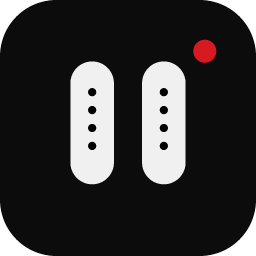
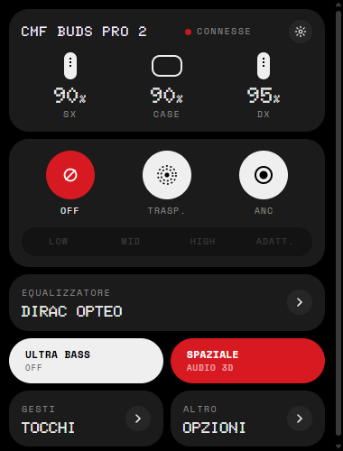
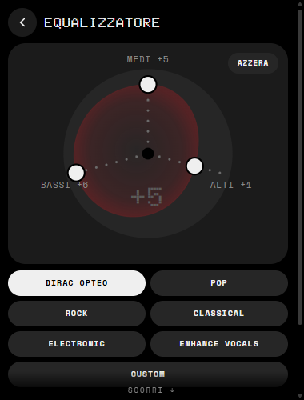

<p align="center">
  
</p>

<h1 align="center">Nothing X Desktop <sub><sup>(unofficial)</sup></sub></h1>

<p align="center">
  Battery, noise control, equalizer, gestures and more for Nothing and CMF earbuds, from your desktop.<br>
  A tray icon, a panel in the Nothing widget style, no account, no cloud.
</p>

<p align="center">
  <a href="https://github.com/raffycaccia/nothing-x-desktop-unofficial/actions/workflows/ci.yml"></a>
  <a href="https://github.com/raffycaccia/nothing-x-desktop-unofficial/releases/latest"></a>
  <a href="LICENSE"></a>
  
  
</p>

<p align="center">
  
  
</p>

> **Not affiliated with Nothing Technology Limited.** "Nothing", "Nothing X" and "CMF" are trademarks of
> their owners. This is an independent, community-made tool.

## Why

Windows, Linux and macOS show a single battery percentage for Bluetooth earbuds and nothing else. The
official Nothing X app exists for phones only. This app speaks the earbuds' own control protocol over the
Bluetooth link the operating system already has, so everything the phone app can set, you can set from the
desktop, live.

## Features

| | |
|---|---|
| **Battery** | Left, right and case, with charging indication. On Windows the tray icon itself shows the lowest bud's percentage as a dot-matrix number. A system notification fires once per bud when it reaches your low-battery threshold. |
| **Noise control** | Off, Transparency, ANC with Low / Mid / High / Adaptive levels. |
| **Equalizer** | The presets of your model (Dirac Opteo, Pop, Rock, Classical, Electronic, Enhance vocals, Custom, or Balanced / More Bass / More Treble / Voice) and a **custom three-band equalizer** on a radial dial, like the phone app's "Simple" mode. |
| **Sound** | Ultra Bass / Bass Enhance with levels, Spatial audio, Low latency, Smart ANC, Personalised ANC, Smart Free, codec. |
| **Gestures** | Double / triple tap, press-and-hold, double-tap-and-hold for each bud, and the case dial (press, double, triple, hold, rotate, in-call actions) where the model has one. |
| **Earbuds** | Find earbuds (ring left / right), ear tip fit test, in-ear detection, dual connection. |
| **Live** | One persistent link; changes made from the phone or the earbuds show up instantly. |
| **Settings** | Language (English, Italian), launch at login, tray battery digits, low-battery threshold. |

Controls appear only when the connected earbuds actually answer the corresponding command, so each model
sees its own feature set.

## Install

### Windows

1. Download `NothingX-Desktop-unofficial-windows-x64.exe` from the
   [latest release](https://github.com/raffycaccia/nothing-x-desktop-unofficial/releases/latest).
2. Run it. An icon appears in the notification area (it may be under the `^` overflow; drag it onto the
   taskbar). Left-click opens the panel, right-click opens the menu.
3. Open *Settings* (gear in the panel) and turn on *Launch at login* if you want it always there.

The panel is rendered by Microsoft Edge (present on every Windows 10/11); Chrome, Chromium or Brave are
used when Edge is missing. The exe is not code-signed, so SmartScreen will ask once.

### Linux

```sh
tar xzf NothingX-Desktop-unofficial-linux-x64.tar.gz
./nothingx/install.sh          # ~/.local/bin/nothingx + launcher entry
nothingx
```

Needs BlueZ (`bluetoothctl`), a Chromium-based browser for the panel window and, for low-battery
notifications, `notify-send` (package `libnotify-bin` / `libnotify`). The status-bar icon uses
[pystray](https://github.com/moses-palmer/pystray); on desktops without an AppIndicator/system tray the
app runs as a plain window instead. Tested in CI only: hardware reports are
[very welcome](../../issues/new?template=device_support.yml).

### macOS (experimental)

Apple Silicon: unzip `NothingX-Desktop-unofficial-macos-arm64.zip`, move `NothingX.app` to Applications, right-click → Open the
first time (the app is not notarized). macOS will ask for Bluetooth permission.

Intel Macs: install with pip (below). The macOS transport goes through IOBluetooth via pyobjc and was written without a Mac to test on. It may
need fixes; please open an issue with what you see.

### From source / pip

```sh
python -m pip install "nothing-x-desktop-unofficial @ git+https://github.com/raffycaccia/nothing-x-desktop-unofficial"
# Linux:  add [tray]     macOS: add [macos]
nothingx            # or:  python -m nothingx
```

Python 3.10 or newer. On Windows the runtime has **zero dependencies**: standard library only.

## Supported devices

The protocol is shared across Nothing and CMF products. The model table (76 SKUs, 22 model bases) comes
from the [ear-web](https://github.com/radiance-project/ear-web) project; the app also works with unknown
SKUs, it just cannot name them or pick model-specific labels.

| Model | Base | Status |
|---|---|---|
| CMF Buds Pro 2 | B172, B195 | **Verified on hardware** |
| CMF Buds, CMF Buds 2, CMF Buds 2 Plus, CMF Buds 2a | B168, B179/B197, B184, B185 | Same command family as the Pro 2, untested |
| CMF Headphone Pro, CMF Clip Pro | B175, B189 | Untested |
| Nothing Ear (1), Ear (2), Ear (Stick), Ear, Ear (a), Ear (open), Ear (3), Ear (3a) | B181, B155, B157, B171, B162, B174, B173, B190 | Untested |
| Nothing Headphone (1), Headphone (1) Pro, Headphone (a) | B170, B192, B186 | Untested |
| Buds Pro, Neckband Pro | B163, B164 | Untested |

"Untested" means the commands were taken from the official app and ear-web for that model but nobody has
confirmed them on hardware yet. A [device report](../../issues/new?template=device_support.yml) is all it
takes to move a line up.

## How it works

```
 earbuds ──RFCOMM (NTAPP service)──  nothingx/link.py  ──state──  local HTTP + SSE  ──  ui.html in a Chromium --app window
                                      protocol.py                  app.py                 tray_win.py / tray_any.py
```

* **Protocol** (`protocol.py`): 10-byte framing with CRC-16/MODBUS, get/set/reply/push command spaces, the
  per-model command table and the decoders. See [docs/PROTOCOL.md](docs/PROTOCOL.md).
* **Link** (`link.py`): finds paired Nothing/CMF devices (Windows registry, `bluetoothctl`, IOBluetooth),
  probes the RFCOMM channel once and caches it, keeps one connection open and mirrors every reply and
  push into a state dict.
* **UI**: a single HTML file served on `127.0.0.1:47816`, updated through Server-Sent Events. The window is
  the system's Chromium in `--app` mode; on Windows its title bar is stripped and the window is clipped and
  placed above the tray icon so it behaves like a flyout.

The server binds to localhost only. Nothing leaves your machine.

## Building

```sh
python -m pip install -e ".[dev,tray]"
pyinstaller nothingx.spec        # dist/NothingX.exe | dist/NothingX | dist/NothingX.app
```

Pushing a tag `vX.Y.Z` runs [release.yml](.github/workflows/release.yml), which tests on all three platforms,
builds the binaries and attaches them to a GitHub release. [ci.yml](.github/workflows/ci.yml) runs the test
suite and a build smoke test on every push and pull request.

## Contributing

See [CONTRIBUTING.md](CONTRIBUTING.md). Device reports and Linux/macOS testing are the most valuable things
you can send.

## Acknowledgements

* [ear-web](https://github.com/radiance-project/ear-web) (AGPL-3.0) by the Radiance project: the first
  open implementation of the protocol and the source of the model table.
* The official Nothing X app, whose command tables were studied to confirm and extend the protocol.
  No code or assets from it are included here.
* Typography: [Doto](https://fonts.google.com/specimen/Doto) and
  [Space Mono](https://fonts.google.com/specimen/Space+Mono) (OFL), loaded from Google Fonts.

## License

[GPL-3.0-or-later](LICENSE). The model table in `nothingx/models.json` is derived from ear-web and remains
available under the AGPL-3.0 as well.
